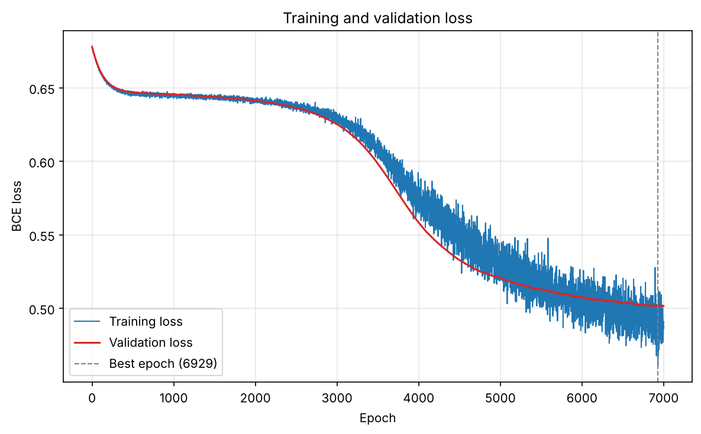
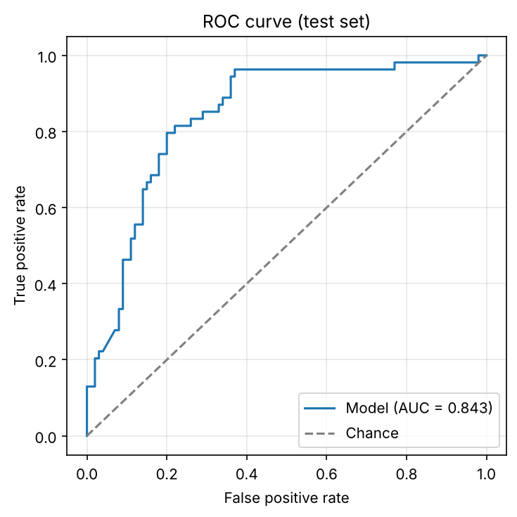

# Diabetes Prediction with PyTorch

[](https://github.com/minalotfy0-web/health-classifier-diabetes-prediction-pytorch/actions/workflows/ci.yml)


[](LICENSE)

A feed-forward neural network that predicts whether a patient has diabetes from eight routine medical measurements, trained on the [Pima Indians Diabetes Database](data/README.md). Originally built for the Systems Engineering module (WiSe 2023/24).

## Results

Test set (154 patients, never used for training or model selection):

<!-- RESULTS:START -->
| Accuracy | Precision | Recall | F1 | ROC AUC |
|---|---|---|---|---|
| 77.3 % | 67.3 % | 68.5 % | 67.9 % | 0.843 |
<!-- RESULTS:END -->

<p align="center">
  
  
</p>

All runs are logged in [`results/trials.csv`](results/trials.csv); the latest run's full metrics are in [`results/metrics.json`](results/metrics.json).

## Quick start

```bash
git clone https://github.com/minalotfy0-web/health-classifier-diabetes-prediction-pytorch.git
cd health-classifier-diabetes-prediction-pytorch
pip install -r requirements.txt -e .
python -m diabetes_classifier
```

Every setting lives in [`config.yaml`](config.yaml) and can be overridden from the command line:

```bash
python -m diabetes_classifier --epochs 5000 --lr 0.05 --hidden-sizes 32 16 8 --output-dir runs/small
```

Add `--pairplot` to redraw the feature scatter matrix and `--show` to open the figures in a window.

## Method

| Step | Choice |
|---|---|
| Split | Stratified 70 % train / 10 % validation / 20 % test (seed 974) |
| Preprocessing | `StandardScaler` fitted on the training set only |
| Model | 8 → 8 → 16 → 32 → 16 → 8 → 1, ReLU activations, dropout 0.5 after the fourth hidden layer |
| Loss | Binary cross-entropy on logits (`BCEWithLogitsLoss`) |
| Optimiser | Full-batch SGD, learning rate 0.01, 7000 epochs |
| Model selection | Weights from the epoch with the lowest validation loss are restored before testing |
| Metrics | Accuracy, precision, recall, F1, ROC AUC, confusion matrix |

## Project structure

```
├── config.yaml                 experiment settings
├── data/                       dataset and its description
├── src/diabetes_classifier/
│   ├── data.py                 loading, splitting, scaling
│   ├── model.py                network definition
│   ├── train.py                training loop with best-epoch checkpointing
│   ├── evaluate.py             metrics
│   ├── plots.py                figures
│   ├── experiment.py           end-to-end run, outputs and trial log
│   └── cli.py                  command-line interface
├── results/                    metrics, figures and trial logs
└── tests/                      pytest suite (run with `pytest`)
```

## Original report version

The code exactly as used for the course report is tagged [`report-2024`](https://github.com/minalotfy0-web/health-classifier-diabetes-prediction-pytorch/tree/report-2024). That version used the test set to choose the number of epochs, which makes its test scores slightly optimistic; this version selects the epoch on a separate validation set instead. Its best trial reached 81.2 % test accuracy and 0.850 ROC AUC; all report trials are in [`results/report_trials.csv`](results/report_trials.csv).

## Development

```bash
pip install -e ".[dev]"
ruff check . && ruff format --check .
pytest
```

## License

[MIT](LICENSE). The dataset is credited in [`data/README.md`](data/README.md).
