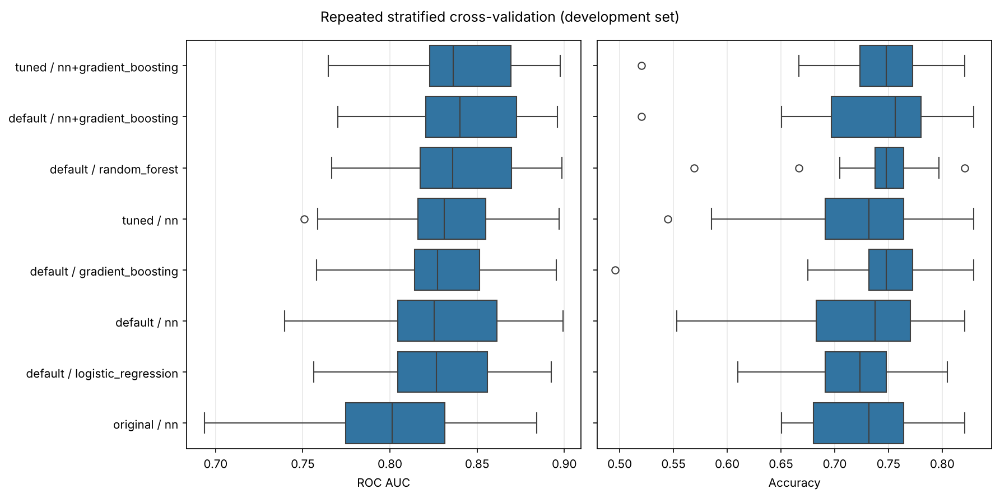
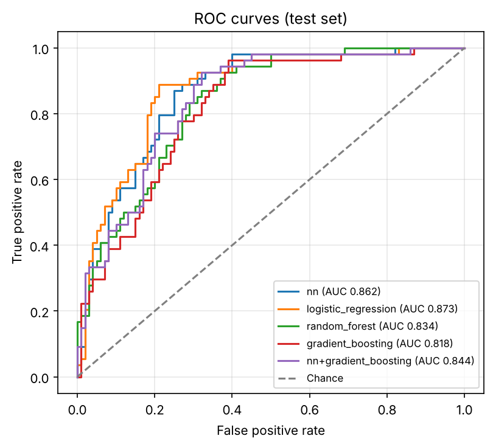
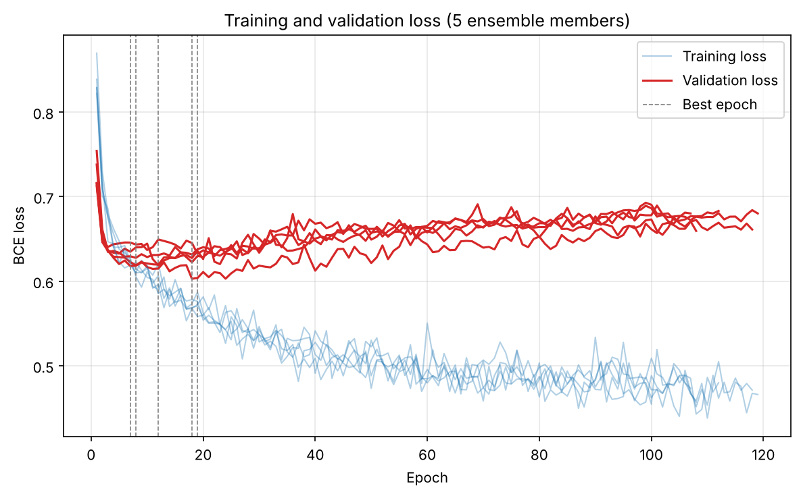

# Diabetes Prediction with PyTorch

[](https://github.com/minalotfy0-web/health-classifier-diabetes-prediction-pytorch/actions/workflows/ci.yml)


[](LICENSE)

A neural-network classifier that predicts whether a patient has diabetes from eight routine medical measurements, trained on the [Pima Indians Diabetes Database](data/README.md) and benchmarked against classical baselines. Originally built for the Systems Engineering module (WiSe 2023/24).

## Results

### Cross-validation (model selection)

5-fold cross-validation repeated 5 times on the development set (614 patients; the test set is not used). Mean ± standard deviation over the 25 folds:

<!-- CV-RESULTS:START -->
| Config | Model | ROC AUC | Accuracy (%) | F1 (%) | Recall (%) |
|---|---|---|---|---|---|
| **tuned** | **`nn+gradient_boosting`** | **0.842 ± 0.034** | **74.0 ± 6.1** | **67.2 ± 5.1** | **76.1 ± 10.5** |
| default | `nn+gradient_boosting` | 0.840 ± 0.035 | 73.6 ± 6.6 | 67.1 ± 5.4 | 76.7 ± 11.3 |
| default | `random_forest` | 0.840 ± 0.035 | 74.5 ± 4.9 | 66.8 ± 6.2 | 74.6 ± 13.8 |
| tuned | `random_forest` | 0.840 ± 0.035 | 74.5 ± 4.9 | 66.8 ± 6.2 | 74.6 ± 13.8 |
| tuned | `nn` | 0.832 ± 0.038 | 72.4 ± 6.4 | 65.1 ± 6.6 | 74.6 ± 15.4 |
| default | `gradient_boosting` | 0.831 ± 0.032 | 74.2 ± 6.2 | 66.4 ± 4.5 | 72.5 ± 10.7 |
| tuned | `gradient_boosting` | 0.831 ± 0.032 | 74.2 ± 6.2 | 66.4 ± 4.5 | 72.5 ± 10.7 |
| default | `nn` | 0.828 ± 0.041 | 72.2 ± 6.7 | 64.5 ± 8.3 | 74.2 ± 18.0 |
| default | `logistic_regression` | 0.827 ± 0.038 | 72.3 ± 4.8 | 64.3 ± 6.4 | 72.7 ± 14.1 |
| tuned | `logistic_regression` | 0.827 ± 0.038 | 72.3 ± 4.8 | 64.3 ± 6.4 | 72.7 ± 14.1 |
| original | `nn` | 0.802 ± 0.046 | 72.7 ± 5.2 | 47.5 ± 25.5 | 43.8 ± 24.8 |
<!-- CV-RESULTS:END -->



### Test set (final evaluation)

154 held-out patients, evaluated once after all choices were made on the development set:

<!-- TEST-RESULTS:START -->
| Config | Model | Accuracy (%) | Precision (%) | Recall (%) | F1 (%) | ROC AUC |
|---|---|---|---|---|---|---|
| tuned | `nn` | 76.6 | 61.5 | 88.9 | 72.7 | 0.862 |
| tuned | `logistic_regression` | 78.6 | 75.6 | 57.4 | 65.3 | 0.873 |
| tuned | `random_forest` | 74.0 | 59.0 | 85.2 | 69.7 | 0.834 |
| tuned | `gradient_boosting` | 73.4 | 59.2 | 77.8 | 67.2 | 0.818 |
| tuned | `nn+gradient_boosting` | 76.0 | 61.6 | 83.3 | 70.9 | 0.844 |
| original | `nn` | 77.9 | 68.5 | 68.5 | 68.5 | 0.843 |

`tuned` / `nn+gradient_boosting` is the final model because it had the highest mean ROC AUC in cross-validation (0.842 vs 0.840 for the best `default` model, a difference far smaller than one standard deviation). The other rows are shown for comparison only; they were not used to choose anything.
<!-- TEST-RESULTS:END -->

<p align="center">
  
  
</p>

> With 154 test patients, one patient is 0.65 percentage points of accuracy, so differences of 1–2 points between models are within noise. Compare models with the cross-validation table.

<!-- FINDINGS:START -->
### Findings

- **Preprocessing, AdamW and early stopping help the network's ranking, not its accuracy.** Compared with `original`, the `default` network raises CV ROC AUC from 0.802 to 0.828 (+0.025 on average over the same 25 folds, better in 21 of them), but that gain is smaller than one fold-to-fold standard deviation (≈ 0.04). Accuracy does not improve (72.7 % vs 72.2 %).
- **The tuned threshold changes the trade-off.** `original` uses a fixed 0.5 and finds only 44 % ± 25 % of diabetics (in some folds almost none). Choosing the threshold for F1 raises recall to about 74 % and F1 from 48 % to 65 %, at the cost of precision. With a validation split of about 60 patients per fold the chosen threshold is noisy, and it causes the low-accuracy outlier folds in the CV figure.
- **The classical baselines are as good as the network.** Logistic regression matches the `default` network (0.827 vs 0.828 ROC AUC), and random forest is slightly better (0.840, ahead in 19 of 25 folds). Gradient boosting is between them (0.831).
- **Ensembling helps a little.** Averaging the network ensemble with gradient boosting gives the best CV ROC AUC (0.840 for `default`, 0.842 for `tuned`), +0.013 over the network alone (ahead in 21 of 25 folds). It is effectively tied with random forest, and all of the differences are within one standard deviation.
- **Tuning gave a negligible gain.** Optuna preferred one wide hidden layer (128 units) with batch norm. Its 26 completed trials were all between 0.804 and 0.841, and the top ten were within 0.006. In repeated CV the tuned network beats `default` by only +0.004 ROC AUC (+0.001 for the blend), and the search used folds of the same development set, so even that small gain is slightly optimistic.
- **The test set confirms there is no clear winner.** The chosen model reaches 76.0 % accuracy and 0.844 ROC AUC, about the same as the original network (77.9 %, 0.843) and within the literature's usual range (76–80 %, 0.83–0.87). On 154 patients these differences are a few patients.
<!-- FINDINGS:END -->

## Quick start

```bash
git clone https://github.com/minalotfy0-web/health-classifier-diabetes-prediction-pytorch.git
cd health-classifier-diabetes-prediction-pytorch
pip install -r requirements.txt -e .

python -m diabetes_classifier cv                        # compare models with repeated CV
python -m diabetes_classifier train                     # train and evaluate on the test set
python -m diabetes_classifier tune --trials 60          # search network hyperparameters
```

Every command takes `--config` (default [`configs/default.yaml`](configs/default.yaml)), and common settings can be overridden: `--max-epochs`, `--lr`, `--hidden-sizes`, `--dropout`, `--ensemble-size`, `--cv-folds`, `--cv-repeats`, `--seed`, `--output-dir`. `cv` accepts several configs at once:

```bash
python -m diabetes_classifier cv --config configs/original.yaml configs/default.yaml configs/tuned.yaml
```

| Config | What it is |
|---|---|
| [`original.yaml`](configs/original.yaml) | The network and optimiser from the course report (full-batch SGD, 7000 epochs, no preprocessing) |
| [`default.yaml`](configs/default.yaml) | The improved setup described below |
| [`tuned.yaml`](configs/tuned.yaml) | `default.yaml` with the network hyperparameters found by `tune` |

## Method

**Evaluation.** The data is split once into a stratified development set (80 %) and test set (20 %). All comparisons and tuning use repeated stratified cross-validation on the development set; inside every fold, a validation split is used for early stopping and for choosing the decision threshold, and the held-out fold is only scored. The test set is used once, at the end.

**Preprocessing** (fitted on training data only):
- Zeros in `Glucose`, `BloodPressure`, `SkinThickness`, `Insulin` and `BMI` mean "not measured" (49 % of `Insulin`, 30 % of `SkinThickness`). They are replaced with the training median, and a `<column>_missing` flag is added.
- `Insulin`, `DiabetesPedigreeFunction` and `Age` are log-transformed, then all features are standardised.

**Network.** A small fully connected network (32 → 16, ReLU, dropout 0.2) trained with AdamW (learning rate 1e-3, weight decay 1e-4) on mini-batches of 32. Training stops when the validation loss has not improved for 100 epochs, the learning rate halves on plateaus, and the best epoch's weights are restored. Positive cases are weighted by the class ratio (about 1.9) to counter the imbalance.

**Decision threshold.** Instead of a fixed 0.5, the threshold that maximises F1 on the validation set is used, trading a little precision for fewer missed diabetics.

**Ensembles.** Five networks trained with different seeds are averaged (`nn`), and that ensemble is also averaged with gradient boosting (`nn+gradient_boosting`).

**Baselines.** Logistic regression, random forest and histogram gradient boosting, with the same preprocessing, class weighting and threshold tuning.

**Tuning.** [Optuna](https://optuna.org) searches depth, width, dropout, batch norm, learning rate, weight decay and batch size, maximising 5-fold cross-validated ROC AUC of a single network on the development set, with median pruning. The best of 60 trials, saved as `tuned.yaml`, is one hidden layer of 128 units with batch norm, dropout 0.26, learning rate 2.9e-3, weight decay 1.4e-3 and batches of 64. Everything else, including the five-network ensemble, is the same as in `default.yaml`.

## Project structure

```
├── configs/                    experiment configurations
├── data/                       dataset and its description
├── src/diabetes_classifier/
│   ├── preprocessing.py        imputation, missing flags, log transform, scaling
│   ├── data.py                 loading and splitting
│   ├── model.py                network definition
│   ├── train.py                mini-batch training with early stopping
│   ├── models.py               network ensemble, baselines and their combination
│   ├── evaluate.py             threshold selection and metrics
│   ├── experiment.py           cross-validation and final test evaluation
│   ├── tune.py                 Optuna hyperparameter search
│   ├── plots.py                figures
│   └── cli.py                  command-line interface
├── results/                    CV results, test results, figures and logs
└── tests/                      pytest suite
```

## Original report version

The code exactly as used for the course report is tagged [`report-2024`](https://github.com/minalotfy0-web/health-classifier-diabetes-prediction-pytorch/tree/report-2024). It chose the number of epochs on the test set, which makes its scores optimistic (best trial: 81.2 % test accuracy, 0.850 ROC AUC; all trials in [`results/report_trials.csv`](results/report_trials.csv)). The same network evaluated properly is the `original` config above.

## Development

```bash
pip install -e ".[dev]"
ruff check . && ruff format --check .
pytest
```

## License

[MIT](LICENSE). The dataset is credited in [`data/README.md`](data/README.md).
