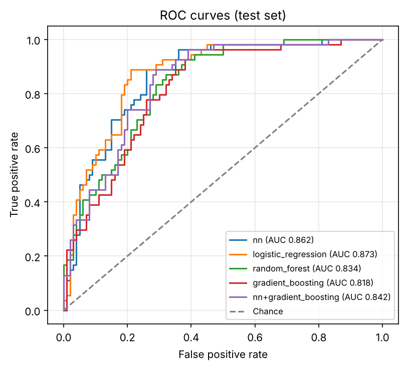
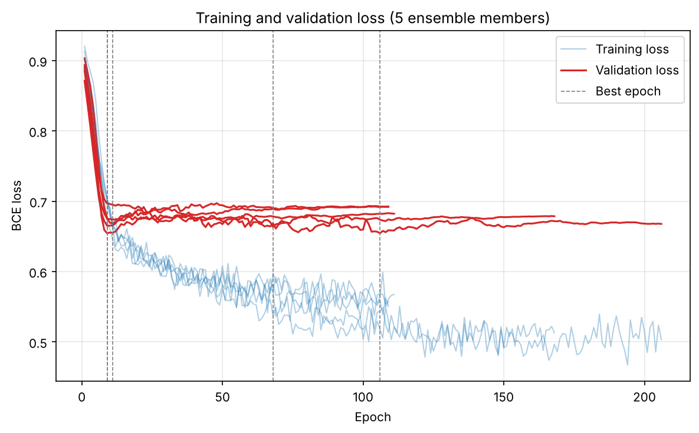

# Diabetes Prediction with PyTorch

[](https://github.com/minalotfy0-web/health-classifier-diabetes-prediction-pytorch/actions/workflows/ci.yml)


[](LICENSE)

A neural-network classifier that predicts whether a patient has diabetes from eight routine medical measurements, trained on the [Pima Indians Diabetes Database](data/README.md) and benchmarked against classical baselines. Originally built for the Systems Engineering module (WiSe 2023/24).

## Results

### Cross-validation (model selection)

5-fold cross-validation repeated 5 times on the development set (614 patients; the test set is not used). Mean ± standard deviation over the 25 folds:

<!-- CV-RESULTS:START -->
_pending_
<!-- CV-RESULTS:END -->


### Test set (final evaluation)

154 held-out patients, evaluated once after all choices were made on the development set:

<!-- TEST-RESULTS:START -->
_pending_
<!-- TEST-RESULTS:END -->

<p align="center">
  
  
</p>

> With 154 test patients, one patient is 0.65 percentage points of accuracy, so differences of 1–2 points between models are within noise. Compare models with the cross-validation table.

<!-- FINDINGS:START -->
<!-- FINDINGS:END -->

## Quick start

```bash
git clone https://github.com/minalotfy0-web/health-classifier-diabetes-prediction-pytorch.git
cd health-classifier-diabetes-prediction-pytorch
pip install -r requirements.txt -e .

python -m diabetes_classifier cv                        # compare models with repeated CV
python -m diabetes_classifier train                     # train and evaluate on the test set
python -m diabetes_classifier tune --trials 60          # search network hyperparameters
```

Every command takes `--config` (default [`configs/default.yaml`](configs/default.yaml)), and common settings can be overridden: `--max-epochs`, `--lr`, `--hidden-sizes`, `--dropout`, `--ensemble-size`, `--cv-folds`, `--cv-repeats`, `--seed`, `--output-dir`. `cv` accepts several configs at once:

```bash
python -m diabetes_classifier cv --config configs/original.yaml configs/default.yaml configs/tuned.yaml
```

| Config | What it is |
|---|---|
| [`original.yaml`](configs/original.yaml) | The network and optimiser from the course report (full-batch SGD, 7000 epochs, no preprocessing) |
| [`default.yaml`](configs/default.yaml) | The improved setup described below |
| [`tuned.yaml`](configs/tuned.yaml) | `default.yaml` with the network hyperparameters found by `tune` |

## Method

**Evaluation.** The data is split once into a stratified development set (80 %) and test set (20 %). All comparisons and tuning use repeated stratified cross-validation on the development set; inside every fold, a validation split is used for early stopping and for choosing the decision threshold, and the held-out fold is only scored. The test set is used once, at the end.

**Preprocessing** (fitted on training data only):
- Zeros in `Glucose`, `BloodPressure`, `SkinThickness`, `Insulin` and `BMI` mean "not measured" (49 % of `Insulin`, 30 % of `SkinThickness`). They are replaced with the training median, and a `<column>_missing` flag is added.
- `Insulin`, `DiabetesPedigreeFunction` and `Age` are log-transformed, then all features are standardised.

**Network.** A small fully connected network (32 → 16, ReLU, dropout 0.2) trained with AdamW (learning rate 1e-3, weight decay 1e-4) on mini-batches of 32. Training stops when the validation loss has not improved for 100 epochs, the learning rate halves on plateaus, and the best epoch's weights are restored. Positive cases are weighted by the class ratio (about 1.9) to counter the imbalance.

**Decision threshold.** Instead of a fixed 0.5, the threshold that maximises F1 on the validation set is used, trading a little precision for fewer missed diabetics.

**Ensembles.** Five networks trained with different seeds are averaged (`nn`), and that ensemble is also averaged with gradient boosting (`nn+gradient_boosting`).

**Baselines.** Logistic regression, random forest and histogram gradient boosting, with the same preprocessing, class weighting and threshold tuning.

**Tuning.** [Optuna](https://optuna.org) searches depth, width, dropout, batch norm, learning rate, weight decay and batch size, maximising 5-fold cross-validated ROC AUC with median pruning.

## Project structure

```
├── configs/                    experiment configurations
├── data/                       dataset and its description
├── src/diabetes_classifier/
│   ├── preprocessing.py        imputation, missing flags, log transform, scaling
│   ├── data.py                 loading and splitting
│   ├── model.py                network definition
│   ├── train.py                mini-batch training with early stopping
│   ├── models.py               network ensemble, baselines and their combination
│   ├── evaluate.py             threshold selection and metrics
│   ├── experiment.py           cross-validation and final test evaluation
│   ├── tune.py                 Optuna hyperparameter search
│   ├── plots.py                figures
│   └── cli.py                  command-line interface
├── results/                    CV results, test results, figures and logs
└── tests/                      pytest suite
```

## Original report version

The code exactly as used for the course report is tagged [`report-2024`](https://github.com/minalotfy0-web/health-classifier-diabetes-prediction-pytorch/tree/report-2024). It chose the number of epochs on the test set, which makes its scores optimistic (best trial: 81.2 % test accuracy, 0.850 ROC AUC; all trials in [`results/report_trials.csv`](results/report_trials.csv)). The same network evaluated properly is the `original` config above.

## Development

```bash
pip install -e ".[dev]"
ruff check . && ruff format --check .
pytest
```

## License

[MIT](LICENSE). The dataset is credited in [`data/README.md`](data/README.md).
